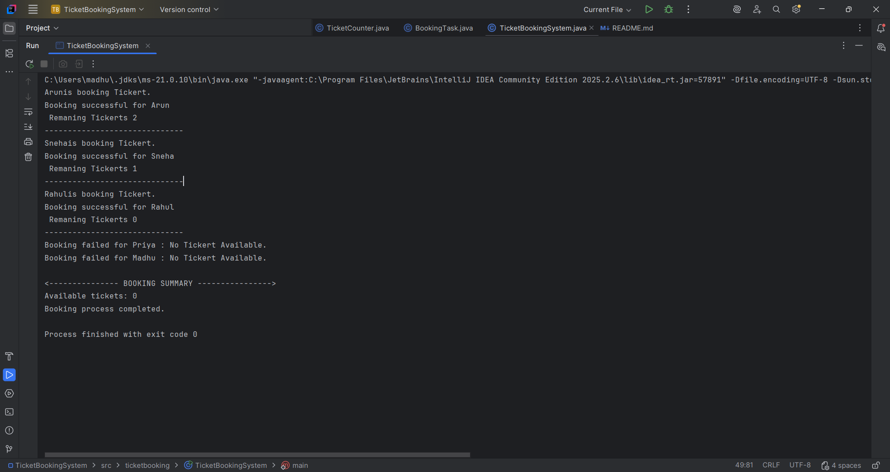

# Ticket Booking System

## 1. Project Overview

The Ticket Booking System is a Java application developed for the
Multithreading and Advanced Java Programming assignment.

It allows multiple customers to book tickets concurrently.
The application uses a thread pool to process booking requests and
synchronization to prevent more tickets from being booked than are available.

## 2. Technologies Used

- Java 21
- IntelliJ IDEA Community Edition
- Java Concurrency API

## 3. Project Structure

```text
TicketBookingSystem/
├── src/
│   └── ticketbooking/
│       ├── TicketBookingSystem.java
│       ├── TicketCounter.java
│       └── BookingTask.java
└── README.md
```

## 4. Explanation of Java Classes

### TicketBookingSystem.java

This is the main class and starting point of the application.

Responsibilities:
- Creates the ticket counter.
- Defines customer booking requests.
- Creates a thread pool using ExecutorService.
- Submits booking tasks for execution.
- Shuts down the executor after submitting tasks.
- Waits for booking tasks to finish.
- Displays the final booking summary.

### TicketCounter.java

This class manages the available ticket count.

Responsibilities:
- Stores the number of available tickets.
- Checks whether tickets are available.
- Decreases the ticket count after a successful booking.
- Displays a failure message when no tickets remain.
- Uses synchronized methods to protect shared ticket data.

### BookingTask.java

This class represents an individual customer's booking request.

Responsibilities:
- Implements the Runnable interface.
- Stores the customer's name and shared TicketCounter object.
- Calls the booking method to process the request.
- Handles runtime exceptions and displays an error message.

## 5. How the Application Works

1. The main class creates a TicketCounter object.
2. It creates a fixed thread pool using ExecutorService.
3. Each customer is represented by a BookingTask.
4. The executor schedules booking tasks for execution.
5. The synchronized booking method checks and updates the ticket count safely.
6. Customers receive success or failure messages.
7. The executor shuts down and the program displays the final ticket count.

## 6. Advanced Java Concepts

### Multithreading and Concurrency
Multiple customer booking tasks can execute concurrently using a thread pool.

### Runnable Interface
BookingTask implements Runnable to represent work that a thread can execute.

### ExecutorService
ExecutorService manages worker threads and executes submitted booking tasks.

### Synchronization
The synchronized keyword prevents multiple threads from executing the same
synchronized instance method on the same TicketCounter object simultaneously.

### Thread Safety
Synchronization protects the shared ticket count and prevents overbooking.

### Exception Handling
The application handles runtime exceptions in booking tasks and interrupted
waiting during executor shutdown. Invalid user input handling is not applicable
to the current hardcoded-value version.

### Resource Management
The application shuts down the executor and waits for booking tasks to finish.
It requests interruption if tasks do not terminate within the waiting period.

## 7. Test Case

### TC-01: More Customers Than Available Tickets

**Objective:** Verify that the system prevents overbooking when more customers
attempt to book tickets than the number of tickets available.

**Test Data:**
- Total tickets: 3
- Total customers: 5
- Customer names: Arun, Sneha, Rahul, Priya, Madhu

**Expected Result:**
- Successful bookings: 3
- Failed bookings: 2
- Available tickets: 0

**Actual Result:**
Three customers booked successfully. The remaining two booking requests failed
because no tickets were available. The final ticket count was zero.

**Test Case Output:**



**Status:** PASS

**Explanation:**
The synchronized booking method protects the shared ticket count.
Although five customers submit booking requests, only three tickets are available.
The remaining two requests fail, and the system does not overbook.

The order of customer booking messages may vary because the tasks execute
concurrently.

## 8. Conclusion

The Ticket Booking System demonstrates multithreading, concurrency,
Runnable, ExecutorService, synchronization, thread safety, exception handling,
and resource management in Java.

It shows how synchronization can protect shared data when multiple tasks
attempt to access and modify the same resource.